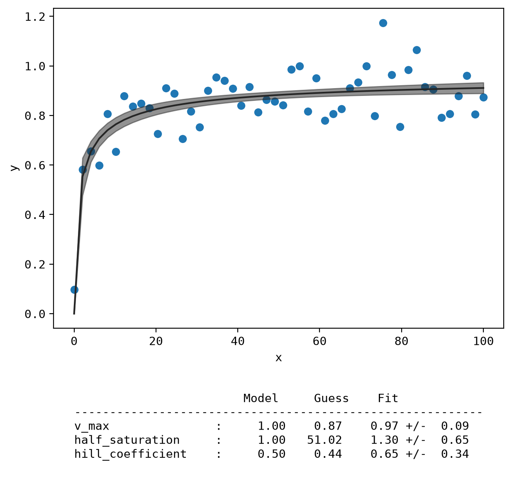
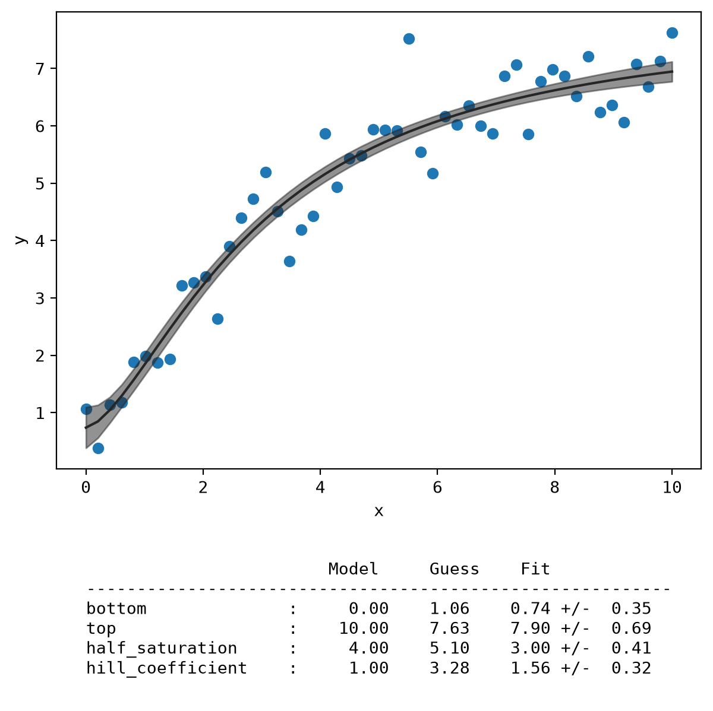
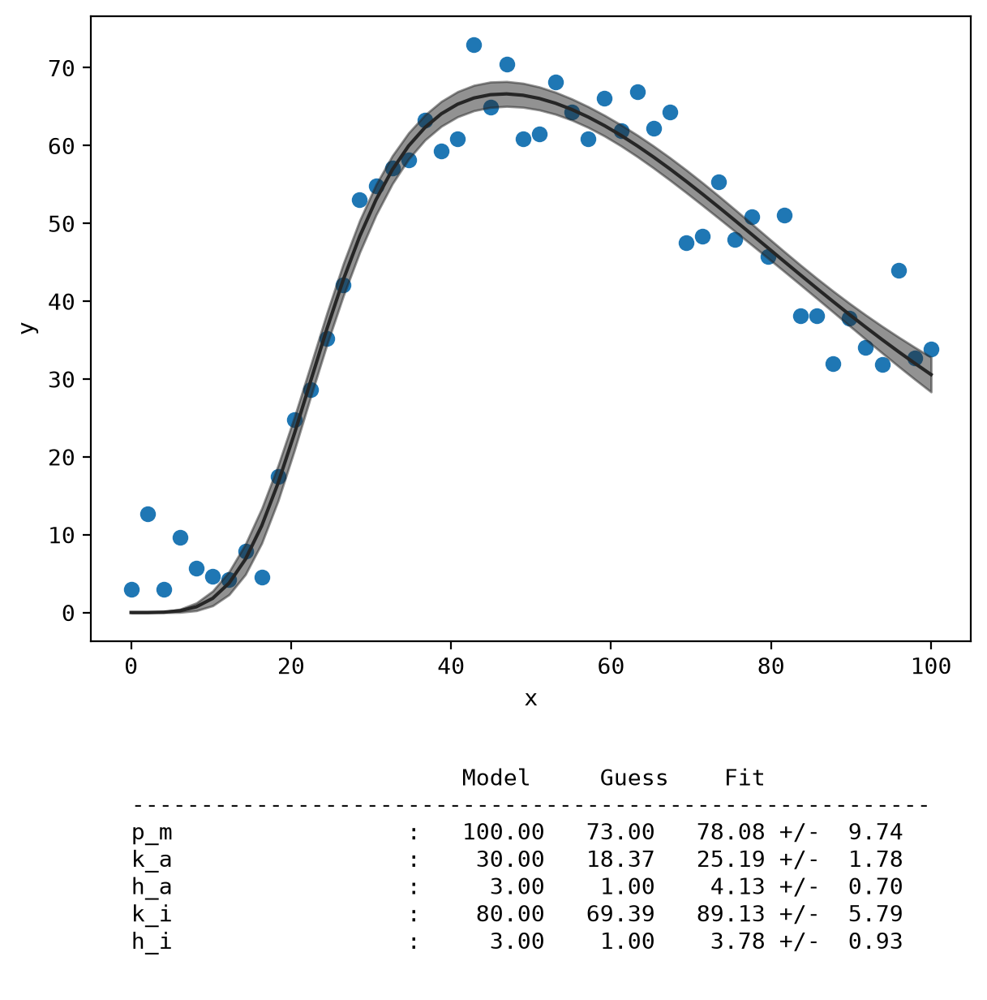

# Binding Plot

Plots the output of the [Binding Data](binding_data.md) widget and fits it with a Hill-type equation.

## Controls

- **X variable** / **Y variable**: the columns to plot. They default to `Hill Conc [B]` and `Hill Delta A`, the micromolar concentration and the delta A per cm that CD Apps used for its Hill fit, so that fitted parameters can be compared with CD Apps. If the table has no such columns they default to `Titration point` and `Delta A`.
- **Point size** and **Fit line width**: appearance of the plot.
- **Select fit model**: one of the equations below.
- **Fit model** runs the fit with lmfit and draws the curve; **Clear fit** removes it.

## Output

**Hill Fit Results**: one row per fitted parameter (plus `r_sq` and `red_chi_sq`) with its `Estimate`, `Standard Error` and `Unit`.

The fitting needs at least four finite points with distinct, non-negative x values.

## Choosing the x and y variables

The fitted parameters depend on the units of the data that was fitted, so fits are only comparable when the same variables are used.

- **x and the half-saturation constant.** `K_half` (and `k_a`, `k_i`) is an x value, so it is in the units of the x variable. For the same data it is, for example, about 0.5 against `Titration point`, 9.7 against `Hill Conc [B]` (micromolar) and 9.7×10⁻⁶ against `Conc [B]` (molar). CD Apps fitted against the concentration of B in micromolar, which is what `Hill Conc [B]` holds.
- **y and the amplitude.** Absorbance grows with the pathlength of the cell (A = ε·c·l), so the same sample gives a different `Delta A` in cells of different pathlength. `v_max`, `top`, `bottom` and `p_m` are only comparable between experiments once the signal is scaled to a common pathlength. CD Apps divided delta A by the pathlength, giving delta A per 1 cm, which is what `Hill Delta A` holds.

The defaults (`Hill Conc [B]` and `Hill Delta A`) therefore reproduce the CD Apps Hill fit. Choose `Titration point` and `Delta A` instead to fit against the molar ratio and the measured signal.

## Hill model (3 variable)

The Hill equation is defined as:

$y = V_{max} * \frac{x^n }{K_{half}^n + x^n}$

## Hill model (4 variable)

The Modified Hill equation adds an additional variable to potentially better fit the initial and final plateaus of the data:

$y = bottom + (top - bottom) * \frac{x^n }{K_{half}^n + x^n}$

## BiHill model

The BiHill equation is defined as:

$y = \frac{p_m}{\left[ 1 + \left( \frac{k_a}{x} \right )^{h_a} \right]\left[ 1 + \left( \frac{x}{k_i} \right )^{h_i} \right]}$

